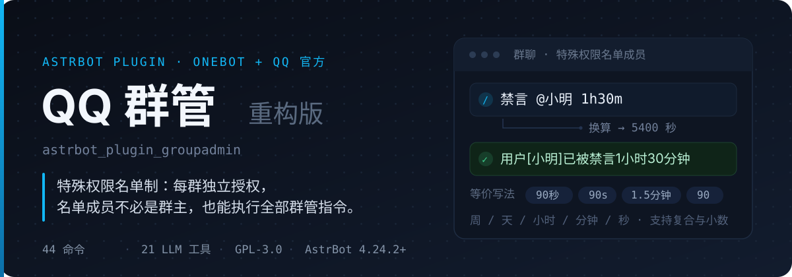
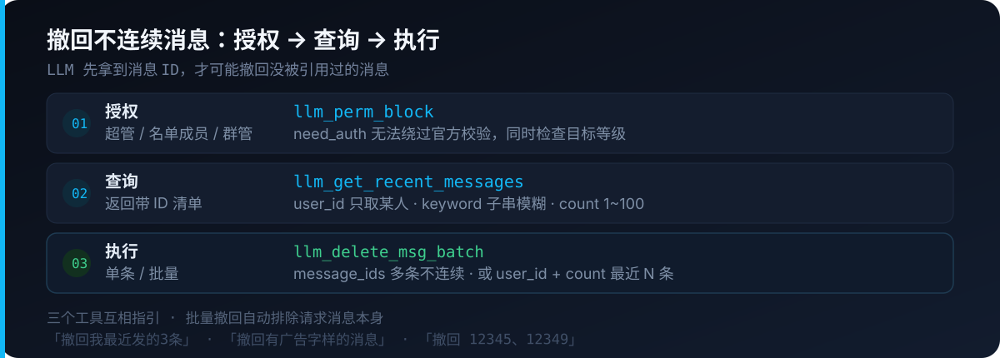

<div align="center">

# QQ 群管（重构版）

**用「特殊权限名单」代替军衔制：谁干活，谁上名单，不必是群主。**

<p>
  
  
  
  
  
</p>

<p>
  
</p>

[权限模型](#权限模型) · [命令清单](#命令清单) · [LLM 工具](#llm-工具) · [WebUI](#webui-配置) · [安装](#安装)

</div>

---

## 为什么要重写权限

原版按「QQ 军衔」发权限：你是群主就全给，你是成员就都别想。现实里常见的是另一套关系——**帮你管群的人，未必挂着管理员**。

于是这个版本把判定翻过来：**每群一份名单，进名单即拥有该群全部群管指令**。名单存在数据库 `special_admins` 字段，QQ 号与官方平台 OpenID 放同一个列表，互不干扰、互不换算。

<table>
<tr><td width="50%">

**不再有的事**

- ❌ `perms` 每命令权限门槛（30 项配置全部删除）
- ❌ 投票禁言 / 投票踢人
- ❌ 等级体系与进群等级门槛
- ❌ 清理不活跃群友
- ❌ 宵禁
- ❌ 违禁词 / 刷屏自动禁言

</td><td width="50%">

**换来的是**

- ✅ 名单成员一条命令干完所有活
- ✅ 名单每群独立，A 群的帮手进不了 B 群
- ✅ 名单成员**不被保护**——能被禁言、能被踢
- ✅ 超管在 WebUI 里逐行填号码即可，无需重启
- ✅ 官方机器人同样走名单（可关）

</td></tr>
</table>

<p align="center">
  
</p>

| 级别 | 谁 | 能做什么 |
|---|---|---|
| **AstrBot 超级管理员** | `admins_id` 里配置的账号 | 全部指令 + 各群名单管理 + 群配置导入导出 / 重置 |
| **特殊权限名单成员** | 每群独立名单 | 本群全部群管指令，无需群主 / 管理员身份 |
| **QQ 群主 / 管理员** | 群内身份 | 基础管理指令 + 查询指令 |
| **普通成员** | 其余群友 | 仅查询：群友信息 / 群公告 / 群文件 |

> 一句话记住边界：**名单给的是权限，不是豁免。** 名单成员照样会被别人禁言、踢出。

---

## 命令清单

群内发送 `/群管帮助` 可看完整用法。标 ✅ 的已注册为 LLM 工具。

### 管理类

| 指令 | 说明 | LLM |
|---|---|:--:|
| `禁言 @用户 时间` | 时间支持单位换算，纯数字按秒 | ✅ |
| `禁言 QQ号1,QQ号2 时长` | 按 QQ 号批量禁言，多人共用同一时长 | ✅ |
| `禁言 QQ号1,QQ号2 时长1,时长2` | 多人各禁不同时长，按位置一一对应 | ✅ |
| `娱乐式禁言 @用户 时间` | 下发禁言后 1 秒自动解禁，提示与普通禁言一字不差<br>别名：`玩笑禁言` / `吓唬禁言` | ✅ |
| `解禁 @用户` | 解除禁言 | ✅ |
| `全禁 开` / `全禁 关` | 全员禁言 | ✅ |
| `改名 <新昵称> @用户` | 修改群名片 | ✅ |
| `改头衔 <头衔> @用户` | 设置群头衔（需群主） | ✅ |
| `申请头衔 <头衔>` | 为自己申请头衔 | ❌ |
| `踢了 @用户` | 移出群聊 | ✅ |
| `群拉黑 @用户` | 踢出并拉黑 | ✅ |
| `上管 @用户` / `下管 @用户` | 设置 / 取消管理员（需群主） | ❌ |
| `设精` / `移精`（引用消息） | 群精华操作 | ✅ |
| `撤回`（引用消息）<br>`撤回 @用户 数量` | 单条撤回，或批量撤回某人的最近 N 条 | ✅ |
| `发布群公告 <内容>` | 可引用图片 | ✅ |
| `设置群头像`（引用图片） / `设置群名 <新群名>` | 群资料 | ✅ |
| `上传群文件` / `删除群文件` | 群文件管理 | ✅ |

### 进群审核与退群

| 指令 | 说明 | LLM |
|---|---|:--:|
| `进群审核 开` / `进群审核 关` | 进群模块总开关 | ❌ |
| `进群白词 <词>` / `进群黑词 <词>` | 自动通过 / 拒绝关键词 | ❌ |
| `未命中驳回 开` / `进群次数 <n>` | 申请策略 | ❌ |
| `进群黑名单 +QQ号` / `-QQ号` | 管理进群黑名单 | ❌ |
| `进群禁言 <秒>` / `进群欢迎 开` | 新成员处理 | ❌ |
| `退群通知 开` / `退群拉黑 开` | 退群处理 | ❌ |
| `批准` / `驳回 <理由>` | 人工审批进群申请 | ❌ |

### 查询类（全员可用）

| 指令 | 说明 | LLM |
|---|---|:--:|
| `群友信息` | 群成员列表与活跃情况 | ❌ |
| `群公告` | 查看群公告 | ✅ |
| `群精华` | 精华消息列表 | ✅ |
| `查看群文件` | 群文件列表 / 详情 | ✅ |
| `群管帮助` | 命令帮助 | ❌ |

### 超管专用

| 指令 | 说明 |
|---|---|
| `特殊权限 查看` / `添加 @成员` / `删除 @成员` / `清空` | 管理本群特殊权限名单 |
| `群管配置 <群号> <配置串>` | 导出 / 导入群配置 |
| `群管重置 <群号 / all>` | 重置群配置 |
| `群管状态` | 插件运行状态 |

### 时间怎么写都行

解析器认这些写法，结果完全等价：

```text
禁言 @某人 5400      禁言 @某人 5400秒      禁言 @某人 5400s
禁言 @某人 90分钟    禁言 @某人 90min       禁言 @某人 1.5小时
禁言 @某人 1h30m     禁言 @某人 1小时30分
```

单位表：`周 / 星期 / week / w`、`天 / 日 / day / d`、`小时 / hour / h`、`分钟 / min`、`秒 / sec / s`；支持复合（`1h30m`）与小数（`1.5小时`）。

### 批量禁言

不用 @，直接填 QQ 号，多个用逗号分隔（中文逗号、顿号也行）：

```text
禁言 123456,789012 1h              # 两人都禁 1 小时
禁言 123456,789012 1h,2h           # 123456 禁 1 小时，789012 禁 2 小时
禁言 123456,789012,345678 30分,1h,2天
```

规则：

- 时长只有**一个** → 所有目标共用（也可直接写成 `禁言 123,456 3600`，纯数字按秒）
- 时长**与人数相等** → 按位置一一对应，`禁言 123,456 1h,2h` 即 123→1h、456→2h
- 时长**少于人数** → 直接报错并指出差几个，不会乱配
- 时长**多于人数** → 多余的忽略
- 每个目标会单独回执一行，成功的成功、失败的报失败，不会一条失败拖垮整批

### 逐人真假（玩 / 真）

同一批里有人只吓唬、有人真禁言，在末尾加一列开关词，与目标按位置对应：

```text
禁言 123,456 1h,2h 玩,真      # 123 吓唬（1 秒后解禁），456 真禁 2 小时
娱乐式禁言 123,456 1h 玩,真   # 同上
```

| 词 | 含义 |
|---|---|
| `玩` / `假` / `吓` / `吓唬` / `玩笑` | 下发禁言后立刻解禁（1 秒） |
| `真` / `正` / `实` / `正常` | 正常禁言，到期才解 |

- 开关词**出现时**，前面的纯数字一律当 QQ 号（`禁言 123 玩` 是吓唬 123，不是禁 123 秒）
- 开关数量少于人数 → 直接报错，不会静默把该真禁的人当吓唬
- 不填开关词时，`禁言` 全真、`娱乐式禁言` 全玩，保持原行为

> ⚠️ OneBot 11 标准里 `set_group_ban` 的 `duration` **没有 `-1` 表示永久**这个约定（0 才是解禁）。所以本插件不接受 `-1`，最长按服务端上限 30 天（`2592000` 秒）下发，到期续一次即可。

---

## LLM 工具

共 **21 个** `@filter.llm_tool()`。被调用时强制过 `perm_manager` 四级校验——模型无法用 `need_auth=False` 绕过。

| 类别 | 工具 |
|---|---|
| 群管操作 | `llm_set_group_ban`（`user_id` 可填 `1,2,3` 批量 + `durations` 填 `1h,2h,3h` 逐人时长、`instant_unbans` 填 `true,false` 逐人真假，含 `instant_unban` 娱乐式参数）、`llm_set_group_card`、`llm_set_group_special_title`、`llm_set_group_whole_ban`、`llm_set_group_kick`、`llm_set_group_block`、`llm_set_group_name`、`llm_set_group_portrait` |
| 精华 / 公告 / 文件 | `llm_set_essence_msg`、`llm_get_essence_msg_list`、`llm_send_group_notice`、`llm_get_group_notice`、`llm_upload_group_file`、`llm_delete_group_file`、`llm_view_group_file` |
| 撤回 | `llm_delete_msg`、`llm_delete_msg_batch`、`llm_get_recent_messages` |
| 名单 | `llm_get_special_admins` |
| 官方平台 | `qqadmin_official_query`、`qqadmin_official_approval` |

### 撤回没被引用、也不连续的消息

模型看不见消息 ID，就永远只能撤「被引用的那一条」。所以撤回拆成三步：

<p align="center">
  
</p>

```text
「撤回我最近发的 3 条消息」        → llm_delete_msg_batch(user_id="", count=3)
「撤回有广告字样的消息」            → llm_get_recent_messages(keyword="广告")
                                    → llm_delete_msg_batch(message_ids="12345,12349")
「撤回 12345 和 12349 这两条」     → llm_delete_msg_batch(message_ids="12345,12349")
```

- `llm_get_recent_messages`：`count` 1~100（默认 10）；`user_id` 只看某人；`keyword` 子串模糊、大小写不敏感、部分字符即可命中。
- `llm_delete_msg_batch` 双模式：`message_ids` 优先，否则走 `user_id` + `count`；**自动排除请求消息本身**。
- 批量撤回走大窗口（`max(count×5, 50)`）+ 目标过滤，中间夹别人的话不会漏撤。

> 使用前提：插件已加载、AstrBot 已开启函数调用、会话已绑定。

---

## WebUI 配置

AstrBot 插件页 → 点插件 logo → 「插件行为 → 页面」。

- 左侧群列表（可搜索、手动同步），右侧选中群的配置表单
- 「默认群」是全局模板；新群与未单独配置的群继承它
- 每群第一项「跟随默认配置」：开=继承模板，关=独立
- 每个群的表单顶部就是 **「特殊权限名单」编辑框**，逐行填 QQ 号（官方平台填 OpenID），保存即生效，**无需重启**
- 默认群里的名单是新群模板值；已独立配置的群以自己的名单为准
- 支持浅色 / 深色主题

---

## 安装

```bash
# 放到 AstrBot 插件目录后重载插件
cd AstrBot/data/plugins
git clone https://github.com/YunXi-Aurora/astrbot_plugin_groupadmin.git
```

或在插件管理页「从本地目录安装」选择本目录。要求 **AstrBot ≥ 4.24.2**、Python 3.10+，并通过 `aiocqhttp` 接入 QQ。

**QQ 官方机器人**另有平台限制（OpenID 与 QQ 号不互通、部分接口需开放平台授权、机器人须为群管理员等），见 [OFFICIAL.md](OFFICIAL.md)。

---

## 已知边界

- **只测过 NapCat。** 其他 OneBot 实现的字段差异未逐一验证。
- **官方平台只接了一部分。** 改名、头衔、设管理员、精华、群公告、群文件、历史消息撤回等在官方群不可用。
- **没有自动迁移。** 从原版 `astrbot_plugin_qqadmin` 升级需重新配置；数据库里残留的旧字段会被忽略，不影响运行。
- **名单成员不受保护。** 这是设计选择，不是漏洞。

---

## 致谢与许可

- 原插件：[Zhalslar/astrbot_plugin_qqadmin](https://github.com/Zhalslar/astrbot_plugin_qqadmin)
- 本仓库 fork 自：[wzq10314/astrbot_plugin_qqadmin](https://github.com/wzq10314/astrbot_plugin_qqadmin)
- 特别感谢 [@Nanheqiaobei](https://github.com/Nanheqiaobei)：没有直接提交代码，但本次重构的大体方向由他确定，并积极参与了本插件的测试。
- 沿用 **GPL-3.0**，保留原署名。变更见 [CHANGELOG.md](CHANGELOG.md)。